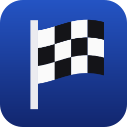

<p align="center"></p>

# sr-recomp (Splatoon Raiders)

A static recompilation of *Splatoon Raiders* (Nintendo Switch 2, Title ID `0400380020056000`, v1.0.0) into a native PC program for Linux, Steam Deck (LCD & OLED), and Windows. It needs your own legal copy of the game dumped from your console (`exefs/` and `romfs/`, or `.nup`/`.nx`): nothing of the game is shipped in this repository or in its releases.

**It is a recompilation, not an emulator.** The game's AArch64 code is translated to C ahead of time and compiled for the PC's CPU (x86-64, or AArch64 on Linux); there is no CPU interpreter or JIT. NVN2, the Switch 2 graphics API, is reimplemented on top of Vulkan at the API level, SM86 shaders are translated to SPIR-V ahead of time, and Nintendo SDK functions (`nn::*`) are replaced natively.

## Key Capabilities & Scope

- **Steam Deck (LCD & OLED) & Linux 60 fps Ready**: Dedicated `MKW_DEVICE_PROFILE=deck` profile (`1280x800`, `720p` internal resolution via `Gyml/Default.game__gfx__parameter__ModuleParam.bgyml`, `85%` scale + AMD FSR 1, dynamic resolution, `60 fps` `fifo` + `low_latency` pacing, lazy GPU mirror write-back `MKW_LAZY_WB=1`). See [docs/steam-deck.md](docs/steam-deck.md).
- **Native Controller Support, Gyro Aiming & Flick Stick**: Steam Deck integrated controls, Xbox, PlayStation, and Switch/Switch 2 (`MKW_SWITCH2`) with auto/manual layout & button prompt icons (`MKW_PAD_LAYOUT`, `MKW_BUTTON_ICONS`), full remapping (`MKW_BIND_*`), analog stick deadzone/rumble curves, six-axis gyro aiming (`MKW_GYRO_MODE=auto|native|stick`, sensitivity, X/Y invert, deadzone, auto drift calibration + manual **Recalibrate gyro**), optional **Flick Stick** (`MKW_FLICK_STICK`, `MKW_FLICK_TIME`), and Steam Input compatibility.
- **Audio & Video Correctness**: Isolated 48 kHz stereo/5.1 audio via `build/lib/` (`libSDL3.so.0`, `libopus.so.0`, `libvpx.so.6`), proper 16:9 presentation inside 16:10 (`1280x800`), zero Vulkan validation errors, zero shader translation failures on active runs.
- **Transactional Save Integrity**: Atomic save commits (`save-tx`), automatic crash rollback/recovery, and rolling backups (`save-backup/`), verified across 6 simulated failure points with `--probe-fs`.
- **Offline Scope**: Nintendo Switch Online / matchmaking / friend services / play reports / wireless `ldn` (`nn::nifm`, `nn::friends`, `nn::ldn`, `nn::nsd`, `nn::prepo`) are **out of scope and stubbed offline** (`runtime/sdk/ov/ov_net.c`) so single-player gameplay works cleanly offline. Optional local subnet sockets (`MKW_LAN=1` via `runtime/sdk/ov/ov_socket.c`) disallow external internet routing.

## Guides & Checklists

- **[Steam Deck & Linux Setup Guide](docs/steam-deck.md)** — Steam Game Mode setup, Launch Options (`LD_LIBRARY_PATH`), `deck` preset details, gyro/Flick Stick setup, graphics options, offline scope, and troubleshooting.
- **[Verification & 100% Playtest Checklist](docs/playtest-checklist.md)** — Automated regression tests/probes plus manual story, combat, save/load crash recovery, controller, and 100% completion checklists.

## Playing & Launching on Linux / Steam Deck

1. Dump *Splatoon Raiders* (`exefs/` and `romfs/`, decrypted) from your Switch 2.
2. Build `build/mkw` (below) and keep the bundled `build/lib/` (`libSDL3.so.0`, `libopus.so.0`, `libvpx.so.6`) next to it.
3. Launch with isolated audio libraries:
   ```sh
   LD_LIBRARY_PATH="$PWD/build/lib" MKW_DEVICE_PROFILE=deck ./build/mkw \
     --exefs "/path/to/exefs" --romfs "/path/to/romfs" --profile "./build/profile" --play
   ```
   See [docs/steam-deck.md](docs/steam-deck.md#adding-to-steam--steam-game-mode) for Steam Game Mode launch options and per-option configuration.

## Graphics, Input & Runtime Highlights

- **Display & Scaling**: Internal game resolution (`MKW_RESOLUTION`: `original|540|720|900|1080|1440|2160`), render scale (`50–200%`), dynamic resolution (`MKW_DYN_RES`), AMD FSR 1 (`EASU` + `RCAS`) or bilinear, sharpness slider, FXAA / Auto AA, texture quality (`full|half|quarter`), anisotropic filtering, particle/post-processing quality, FPS cap (`auto|30|40|60|120|unlimited`), VSync (`fifo|mailbox|immediate`), low-latency frame pacing, HDR, and HUD scale (`75–150%`). *(Note: `MKW_SHADOW_SIZE` and `MKW_DETAIL_DISTANCE` are MKW-specific hooks and no-ops in Splatoon Raiders.)*
- **Controls**: Rebind any action (`MKW_BIND_*`), toggle Nintendo/Xbox/PlayStation/Keyboard prompts, tune gyro aiming (`MKW_GYRO_SENS`, `MKW_GYRO_DEADZONE`, `MKW_GYRO_INVERT_X/Y`, `MKW_GYRO_CALIBRATE`) or Flick Stick (`MKW_FLICK_STICK`, `MKW_FLICK_TIME`), and calibrate rumble curves.

## Building from source

Linux, with `uv`, `clang`, `lld`, `ninja`, SDL3, Opus, libvpx, zstd, xxHash, the Vulkan headers and VMA 3.4.0 (details in [tools/build/README.md](tools/build/README.md)):

```sh
uv run python recomp/gen.py --exefs game/exefs --out build/generated --jobs 8 --patches recomp/patches-sr-100.txt
uv run tools/shaders/extract.py --romfs game/romfs && uv run tools/shaders/translate.py
uv run tools/build/build.py
LD_LIBRARY_PATH="$PWD/build/lib" ./build/mkw --play
```

See [docs/roadmap.md](docs/roadmap.md), [docs/performance.md](docs/performance.md), and [docs/research.md](docs/research.md) for historical Switch 2 engine research inherited from `mkw-recomp`.

| Folder | Contents |
|---|---|
| [recomp/](recomp/README.md) | The generator: AArch64 → C |
| [runtime/](runtime/README.md) | What plays the console: kernel, memory, SDK replacements, NVN2 over Vulkan, audio, input, menus and launcher |
| [sm86/](sm86/README.md) | The shader translator: SM86 SASS → GLSL → SPIR-V |
| [i18n/](i18n/README.md) | The menu, start screen and setup texts in every language (gettext `.po`) |
| [tools/](tools/README.md) | Analysis, setup, build, game runs and diagnostics |
| [tests/](tests/README.md) | Tests without the game or a GPU, in the CI on Linux and Windows |
| [docs/](docs/README.md) | Steam Deck & Linux guides, checklists, research, sources and performance |
| `.github/` | CI, issue and pull request templates |

At the root: `pyproject.toml` and `uv.lock` (the Python environment of the tools), `.gitignore`, `LICENSE`, `CONTRIBUTING.md`, `CHANGELOG.md`, `AGENTS.md`, `.agents-clean`, and `.agents-heavy`.

## Licenses and credits

This project builds on the `mkw-recomp` Switch 2 static recompilation architecture under the [MIT License](LICENSE), alongside code under compatible licenses in [recomp/](recomp/), [runtime/](runtime/), [sm86/decode/](sm86/decode/), and [runtime/third_party/](runtime/third_party/README.md) (`totk-pc-recomp`, `nvsass-disassembler`, `Dear ImGui`, `bc7enc`, `AMD FidelityFX FSR 1`, `Roboto`). See [docs/research.md](docs/research.md#sources) for complete attributions.

*Splatoon Raiders* is © Nintendo. This project is not affiliated with or endorsed by Nintendo, contains no game code or assets, and does not help to obtain them.

## Contributing

See [CONTRIBUTING.md](CONTRIBUTING.md).
